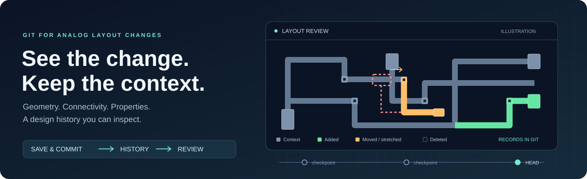

# Analog Layout Diff

<p align="center">
  <picture>
    <source media="(prefers-reduced-motion: reduce)" srcset="assets/banner-static.svg"/>
    
  </picture>
</p>

<p align="center">
  <a href="docs/development/README.md"></a>
  <a href="docs/git/README.md"></a>
  <a href="docs/eda/virtuoso/README.md"></a>
  <a href="docs/eda/klayout/README.md"></a>
  <a href="CONTRIBUTING.md"></a>
</p>

<p align="center">
  <b><a href="#quick-start">Quick start</a></b> ·
  <b><a href="docs/runtime/DEPLOYMENT.md">Deploy to Virtuoso</a></b> ·
  <a href="docs/ui/README.md">GUI guide</a> ·
  <a href="docs/README.md">Documentation</a> ·
  <a href="CONTRIBUTING.md">Contribute</a>
</p>

**Bring Git history into your analog layout workflow.** Save a checkpoint from
Virtuoso, inspect what moved or changed, and open a recorded revision as a
colored native layout review. Geometry, connectivity and properties become
reviewable data alongside the rest of your project.

Native operations use
[virtuoso-bridge-lite](https://github.com/Arcadia-1/virtuoso-bridge-lite).
File-only comparison and replay run independently of Cadence. The banner above
is an original illustration of synthetic geometry, not a GUI screenshot.

## From a layout edit to a design history

**Save → Preview → Commit → Browse → Review**

1. **Save & Commit** saves the edited cellview, previews the change counts, and
   focuses the commit-message field. Press Enter to commit; Cancel keeps the
   layout saved.
2. **History** lets you start with a cell or a Git revision, then explore
   affected cells, files and layout categories.
3. **Review** reconstructs the checkpoint in a temporary read-only layout.
   Toggle highlights, show deleted outlines, or distinguish geometry edits
   from connectivity changes.
4. **Merge** opens native three-way decisions and an editable result, with
   durable undo, isolated two-parent commits, or resolution staging for an
   active Git merge.

The primary layout toolbar keeps **Save & Commit**, **History** and **Merge**
within reach. Diagnostics and background-service controls live below a separator
in the **CIW → Layout Diff** menu. See the [GUI guide](docs/ui/README.md).

## Find the change without losing the context

| You want to know… | Layout Diff shows you |
| --- | --- |
| What changed on this layer? | Category summaries by layer, via definition and instance master, with paged details and full exports |
| Was that shape moved or replaced? | Conservative movement/stretch matching, distinct from ordinary modifications |
| Did connectivity change without changing the drawing? | A separate **Modified net** category and highlight style |
| Where did a deleted object used to be? | Prior-state shadows and group boundaries in the review |
| What is inside the checkpoint? | Deterministic JSONL records in ordinary Git commits, with exact forward/reverse patches |
| Can I reconstruct it? | Native readback checks plus warnings when referenced hierarchy has drifted |

Each review category has its own visibility toggle, color, line style and
optional blinking. Group edits highlight boundaries instead of recoloring every
member. Ambiguous geometric matches remain additions/deletions; the exact stored
operations retain all captured detail.

## Choose your starting point

| Start here | What you need | Guide |
| --- | --- | --- |
| Compare existing snapshots | Python and input files; Git for repository operations | [CLI](docs/ui/CLI.md) |
| Want to commit, compare, review diffs, or merge layouts in Virtuoso? | Running Virtuoso, Bridge connection, technology and masters; deploy the Layout Diff runtime for the native GUI | [Bridge setup](docs/runtime/BRIDGE.md) |
| Use the Virtuoso toolbar | Bridge plus the deployed Layout Diff runtime on the Linux host | [Manual deployment](docs/runtime/DEPLOYMENT.md) |
| Want to review layouts entirely with open-source tools? | KLayout Python bindings for GDS/OASIS review and diff images; no Virtuoso connection needed | [KLayout](docs/eda/klayout/README.md) |

## Quick start

From a checkout, create and activate a virtual environment:

```bash
uv venv .venv
source .venv/bin/activate
uv pip install -e .

# Compare two existing JSON snapshots and replay the change.
python -m layoutdiff diff before.json after.json change.json
python -m layoutdiff apply before.json change.json replayed.json
```

On Windows PowerShell, activate with `.\.venv\Scripts\Activate.ps1`.
For tests and KLayout support, install `uv pip install -e ".[verify]"`.

### Work with a live Virtuoso session

Install the `virtuoso-bridge` distribution into the same environment and follow
[Bridge setup](docs/runtime/BRIDGE.md). Once the intended CIW responds:

```bash
virtuoso-bridge status
python -m layoutdiff capture MY_LIB MY_CELL snapshot.json
python -m layoutdiff restore snapshot.json reconstructed_cell --library TEST_LIB --allow-library TEST_LIB
```

Create a dedicated writable test library with compatible technology first.
Standalone native capture/restore uses the bridge directly; the Layout Diff GUI
worker is not required. Restore refuses an existing destination.

### Put the toolbar in Virtuoso

With the [required checkout layout](docs/runtime/BRIDGE.md#installer-layout-and-host-assumptions),
a working SSH-backed Bridge connection, and `uv` on the remote host:

```bash
python scripts/install_runtime.py --destination /absolute/path/to/layoutdiff_runtime --native auto
```

The installer uploads the packages, prepares the remote environment, generates
`startup.il`, and loads it into the selected CIW. The
[manual deployment guide](docs/runtime/DEPLOYMENT.md) covers named profiles,
updates that preserve settings, later CIW loads, and verification.

## Explore further

| Topic | Read |
| --- | --- |
| Native review, checkpoint restore and merge decisions | [GUI workflows](docs/ui/README.md) |
| Git snapshots, semantic comparison and repository behavior | [Git integration](docs/git/README.md) |
| Packages, processes and the capture-to-review flow | [Architecture](docs/architecture/PROGRAM_STRUCTURE.md) |
| Streaming storage and the optional C++ backend | [Data](docs/data/README.md), [native performance](docs/native-performance/README.md) |
| Static layout review and snapshot images | [KLayout adapter](docs/eda/klayout/README.md) |
| All guides | [Documentation index](docs/README.md) |

## Coverage and recovery

The native codec supports a defined OA/ROD subset. Referenced masters, technology
and PCell programs remain external; hierarchy fingerprints do not archive child
layouts. Unknown content blocks strict reconstruction. Supported-only GUI commits
require explicit loss confirmation and retain an omission audit. Use a separate
database archive for production recovery.

See [native coverage](docs/eda/virtuoso/COVERAGE.md) and
[preservation limits](docs/ui/CLI.md). GDS comparison checks exported geometry
and labels; native readback checks the modeled object attributes and relationships.

## Contribute

Help extend native coverage, improve matching, refine review workflows, or add
synthetic regressions. Start with [CONTRIBUTING.md](CONTRIBUTING.md) and the
[commit convention](docs/development/COMMITS.md).

```bash
python -m pytest tests -q --basetemp=.test-tmp-run
python scripts/check_docs.py
python scripts/check_publication.py
```

Public examples and fixtures use synthetic data. Keep agent instructions, site
configuration and captured designs in ignored local storage.
