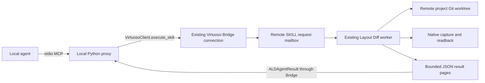

# Agent access through Virtuoso Bridge

Layout Diff adds semantic analysis to the project's existing Git worktree.
Git owns branches, the index, merges and commits. The agent tools read revisions,
explain changes, prepare merge decisions and optionally write selected snapshot
files. They do not create another repository or commit system.

## Local agents, remote layouts



The only local dependencies are Python 3.10+ and `virtuoso-bridge`. The proxy
does not import Layout Diff, read remote paths as local files, or connect to a
remote MCP endpoint. The installed remote worker performs Git reads and layout
analysis. Requests, cached inputs, decision journals and recovery files live
under `<runtime-root>/agent`, outside the project worktree. No extra listening
port, forwarding rule, HTTP server or persistent agent process is required
on the remote host.

The SKILL mailbox immediately acknowledges data-only requests. Python work runs
on the worker's normal poll loop after the SKILL call returns, allowing capture
and readback to call Bridge without waiting inside the submitting CIW callback.
Large layouts stay remote; the agent receives summaries and selected details.

## Setup

1. [Deploy the updated remote runtime](../runtime/DEPLOYMENT.md), load its
   generated `startup.il` into the selected CIW and start the Layout Diff worker.
2. Verify that the same local Bridge configuration/profile reaches that CIW.
3. Copy [layoutdiff_server.py](../../mcp/layoutdiff_server.py) to the local agent
   machine, or reference it in this checkout. Run it with a local Python that
   has Bridge installed. No MCP SDK is required.
4. Register it as a stdio MCP server using the
   [example configuration](../../mcp/mcp.example.json), replacing the example
   interpreter, script, configuration file and profile. `--env` selects a local
   Bridge configuration file; `--profile` selects its named connection.
5. Call `layout_capabilities`. It reports protocol `layoutdiff-agent/1`, worker
   ownership, supported operations, remote state path and native capabilities.

Existing installations need the updated Python package and a worker restart;
copying the proxy alone does not install the remote functions. File-only tool
discovery works before a Bridge connection is available. Actual operations
require a responsive Bridge and running remote Layout Diff worker.

## Tools

| MCP tool | Purpose |
| --- | --- |
| `layout_capabilities` | Discover the connected runtime and protocol. |
| `layout_diff` | Compare Git revisions, `worktree` snapshots or a selected `live` cellview using the viewer's correspondence and classification. |
| `layout_merge_plan` | Analyze base/target/incoming revisions using the merge editor's decision model; defaults target to `HEAD` and base to the unique merge base. |
| `layout_merge_explain` | Explain an ordinary Git merge already in progress, including one started by the agent's own Git command. |
| `layout_merge_apply` | Preview, accept a batch of decisions, or write the fully resolved snapshot to selected worktree files. |
| `layout_export` | Capture a live cellview to the project snapshot paths, with semantic counts and paths for normal Git staging. |
| `layout_result` | Retrieve the original request after a pending, timeout or uncertain transport response without submitting it again. |

All `repository` values are absolute **remote** Git worktree roots. `cellview`
is `[library, cell, view]`. Snapshot paths use the existing
[Git storage conventions](../git/README.md); both v1 JSON and v2 bundles are read.
Existing v1-only cells retain their format on write; new snapshots use v2.

### Semantic diff

For example, call `layout_diff` with:

```json
{"repository":"/projects/example","cellview":["MY_LIB","amp","layout"],"left":"HEAD","right":"worktree","limit":10}
```

The result includes raw operation counts, paired semantic counts, category rows,
changed fields, old/new bounds and correspondence evidence. A confidently paired
stretch or movement appears once instead of as a redundant deletion/addition.
All changed fields remain visible: an object classified as moved can also have
connectivity or property changes. Ambiguous correspondence remains conservative.
Pairing does not alter the exact snapshot data or reconstruction rules.

Use `analysis_id` for subsequent pages. Filter by category, status, layer or
region; regions and bounds use snapshot DBU. `records=true` includes bounded
before/after record summaries. Oversized field values include a preview, byte
count and digest. The response identifies the remote pinned inputs and
exact-operation file; access these paths through Bridge file APIs.
Four diff analyses are cached. Evicted or restarted diff analyses must be
recreated; their temporary exact-operation files expire with the cache.

### Explain a merge started outside Layout Diff

After an ordinary remote `git merge incoming` reports conflicts, call
`layout_merge_explain` with:

```json
{"repository":"/projects/example"}
```

It reads `MERGE_HEAD`, the unique merge base, immutable parent snapshots and
unmerged index stages. It does not parse conflict markers as layouts or write
descriptions into tracked files. Descriptions are structured tool output: each
conflicted cell has a `plan_id`, generation, semantic counts, unresolved decisions,
reasons, correspondence evidence, alternatives and Git conflict paths/stages.
A textual Git conflict may need no semantic decision if the layout changes
combine cleanly.

Ordinary file conflicts are listed separately. Already staged cell resolutions
are retained and listed separately; explicitly querying one reports
`not_unmerged`. Working files, the index and `MERGE_HEAD` remain unchanged.
Octopus merges, multiple merge bases and unrecognized layout storage report an
unsupported reason. Rebase/cherry-pick conflicts are outside this interface;
without `MERGE_HEAD`, it reports no ordinary active merge.

Without `cellview`, `offset`/`limit` page conflicted cells, each with up to three
initial decision summaries. With `cellview`, they page that cell's decisions.
Use its `plan_id` with `layout_merge_plan` for further pages, or supply `unit_id`
for field-level detail, connected context and same-layer cross-branch bounding
box interactions. Interactions are review hints, not DRC or LVS results. At most
eight interactions and fifty selected context keys are returned per decision.
The worker caches four merge analyses/indexes; durable plans survive cache
eviction and restart and rebuild on demand.

### Resolve and write through normal Git

Pass the plan's `generation` and a `decisions` object mapping returned unit IDs
to offered choices (`base`, `target`, `incoming`, and, where supported,
`combined` or `both`).

- `mode="preview"` validates a candidate without changing decisions or project files.
- `mode="accept"` accepts the batch as one durable generation/undo step in remote
  scratch. Use the returned generation on subsequent calls.
- `mode="write"` requires all decisions resolved. By default it reconstructs and
  validates the candidate in a temporary native layout, then writes only the
  selected snapshot and any needed `layouts/.gitattributes` rules. It does not
  modify the source OA cellview. `native_validation=false` explicitly requests
  logical-only output and is identified as such in the result.

Writes recheck the pinned HEAD, branch, merge head, managed-file hashes and
selected index entries under an index lock. Changed inputs require a fresh
analysis. A recovery journal records replaced files; errors attempt rollback
without overwriting newer external edits. This is guarded multi-file publication,
not a filesystem-wide atomic transaction. Incomplete snapshots with omission
audits require the graphical preservation workflow.

The response returns exact changed paths and `staged=false`. The caller runs
normal **remote** Git commands to review/stage those paths, resolve other
conflicts and complete the merge/commit. The tool never stages files, commits,
checks out branches or finishes the merge. A cell with some v2 files already
staged but other files still conflicted is analyzed as a whole from its parents;
review the complete candidate before replacing that cell.

`layout_export` also leaves Git staging to the caller. `save=false` captures the
current native state without saving; `save=true` explicitly saves that selected
cell first. It checks native modification state around capture and reports
hierarchy warnings. Dirty managed snapshot paths require the `worktree_digest`
from an inspected `layout_diff` as `expected_worktree`; active index conflicts
must go through merge explanation/resolution.

## Requests, recovery and direct Bridge access

Operations accept an optional stable `request_id` (1–64 ASCII letters, digits,
underscores or hyphens) and `wait_seconds` (0–30). Results use a protocol envelope
with `status`, `request_id`, and either `result` or an error. A request is immutable:
reusing its ID with different operation/arguments is refused. A matching request
returns its original result; it is not a way to refresh a query.

For `pending`, `running`, `retrieving` or `transport_unknown`, retain the ID and
call `layout_result`. Transport exceptions do not automatically replay writes.
On worker recovery, interrupted running requests become `unknown`, with their
original files and journals retained for inspection. Missing results do not
prove a write never happened. Request receipts and journals have no automatic
expiry; remove them only as deliberate maintenance with the worker stopped and
all uncertain outcomes reconciled. Old IDs must not be reused after removal.

Agents already using Bridge can skip MCP and call the same three SKILL functions
with `execute_skill`:

```lisp
ALDAgentDescribe()
ALDAgentSubmit("inspect_1" "merge_explain" "{\"repository\":\"/projects/example\"}")
ALDAgentResult("inspect_1" 0)
```

`ALDAgentDescribe` returns `(protocol worker-owned capabilities-json)`.
`ALDAgentSubmit` returns `("accepted" id)` or `("existing" id)`.
`ALDAgentResult` returns a pending/running/not-found state, or
`("complete" page-count json-fragment)`. Fetch cursors from zero through
`page-count - 1`, concatenate fragments, then decode JSON. Pages are at most
2048 ASCII bytes before SKILL escaping. Semantic pagination and transport
pagination are separate. The proxy resumes partially fetched results.
These functions accept JSON as data; they never evaluate agent-supplied code.

For file-only jobs when Bridge's SSH interface is available but its CIW is not,
upload a JSON request through Bridge and run this on the **remote host** using
Bridge's existing SSH runner:

```sh
/path/to/runtime/.venv/bin/python -m layoutdiff.agent \
  --root /path/to/scratch/file-agent \
  --request-id inspect_1 --operation merge_explain \
  --payload /path/to/scratch/request.json
```

Use a separate dedicated state root outside Git. This optional one-shot runner
shares the request/result contract but has no live capture or native validation.
It is not an automatic fallback for an uncertain submitted write, and it does
not expose a remote MCP port. The local MCP proxy uses the SKILL path only.

## Verification boundaries

The [agent tests](../../tests/test_agent.py) create real synthetic Git conflicts
for both storage formats and check pairing, explanations, unchanged index/worktree
reads, guarded writes, rollback, generations and recovery. The
[proxy tests](../../tests/test_agent_mcp.py) cover MCP discovery without local
Layout Diff imports, transport exceptions, immutable requests and paged retrieval.

```sh
python -m pytest tests/test_agent.py tests/test_agent_mcp.py -q
```

These tests do not establish native SKILL compatibility or PDK readback on a
particular host. Live verification additionally requires a reachable configured
CIW, the updated worker and a disposable compatible test library. See the
[verification guide](../development/VERIFICATION.md).
