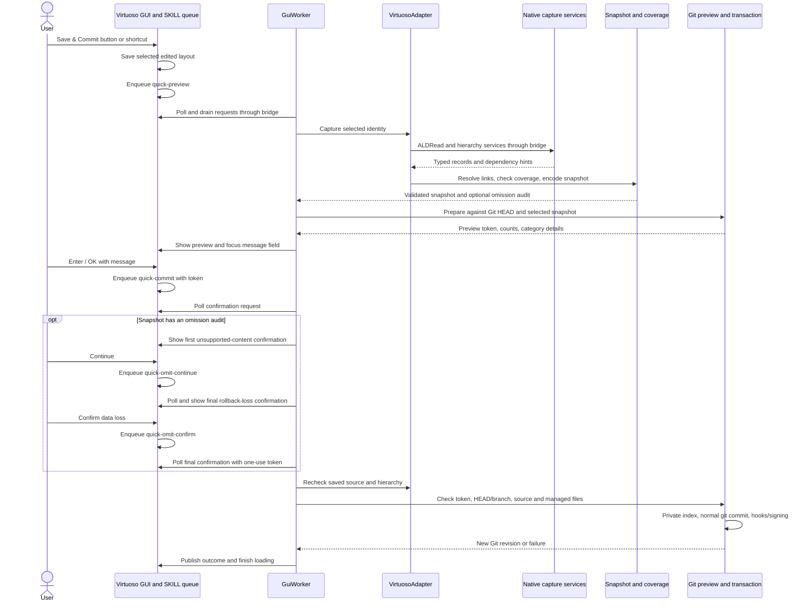
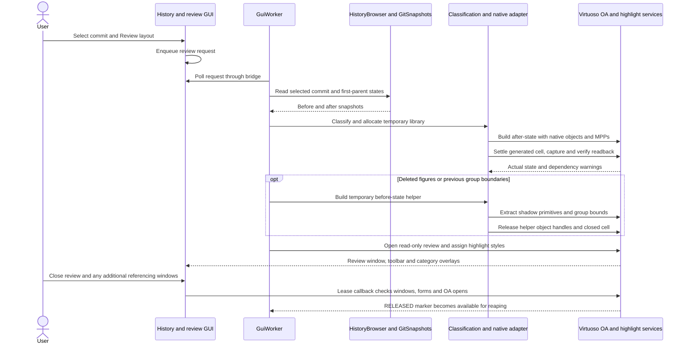

# GUI interaction sequences

Detailed request paths complement the [functional package diagram](PROGRAM_STRUCTURE.md).
The package structure is the overview; these sequences expand individual operations.

## Save and commit interaction

Cancel releases the preview without a Git commit; the initial layout save has
already happened. Preparation and confirmation are separate queued requests
joined by a preview token. The Git transaction preserves unrelated staged and
unstaged work. [Git workflow](../GIT.md) specifies stale-preview rejection,
repository discovery and migration behavior.
Each omission acceptance consumes a separate one-use token; a repeated callback
cannot count as the next confirmation. Rejecting either prompt cancels the commit.

## Review and restore interaction

Category selection does not require native reconstruction; the browser can
display semantic changes from Git/codec/index data alone. Review additionally
needs native masters and technology. Deleted shadows are independent drawing
primitives; the final review does not depend on keeping its before-state helper
cell open. Group boundaries do not recursively recolor every member.

Restore reuses the reconstruction/validation adapter but has a separate
`ui/restore.py` state machine: prepare a verified checkpoint, retain a plan token,
ask for confirmation, recheck the target, create a native backup, replace/save
and verify the working view. Restore does not advance Git; Save & Commit records
the restored state afterward. See [checkpoint workflow](../VIRTUOSO_GUI.md#restore-a-saved-working-layout).
