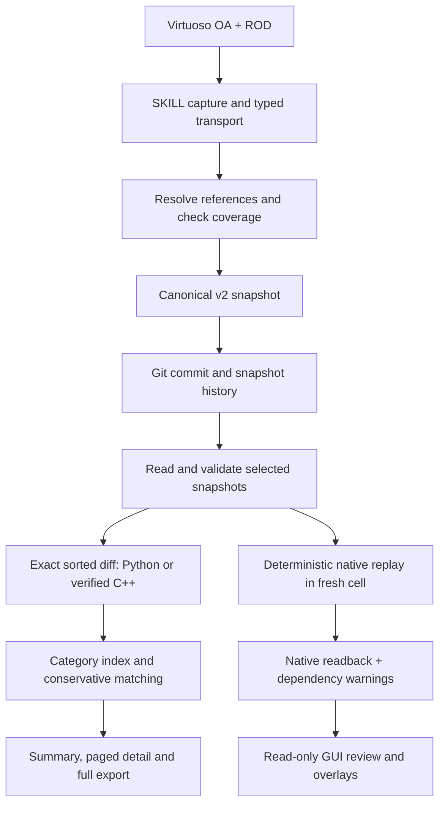

# Layout processing: capture, diff, replay and review

This guide describes the current processing pipeline. The [data model](../data/MODEL.md)
defines the information boundary; [format specifications](../data/STORAGE_FORMAT.md)
define exact serialization. Native API details refer to Virtuoso IC23.1.
For process boundaries, module blocks and GUI interaction sequences, see
[Program structure](PROGRAM_STRUCTURE.md).

## Processing overview



Git browsing reconstructs a selected snapshot directly. The standalone chain
path additionally supports empty snapshot + checked patches = selected state.
Branch creation and automatic merging are outside the primary workflow.

## Capture and coverage

1. SKILL opens the source read-only and emits typed records. Geometry is scaled
   to integer DBU before printing. It collects OA objects and additional ROD
   recipes, avoiding double counting mosaics, annotation indexes or MPP members.
2. Python decodes the transport as data. A disk-backed pass resolves object
   references, embedded pin/instance-terminal aliases, groups and annotations.
   Capture-local handles/IDs are removed before canonical hashing.
3. Coverage scans all supported/unsupported categories and produces complete
   diagnostics. Routes, markers and Steiners are skipped by approved policy.
4. Strict commit paths reject unknown content. The GUI offers Reject or Continue
   and then a second rollback-loss confirmation. Confirmed projection removes
   unsupported records, propagates dependent omissions, detaches retained figures
   from rejected figure groups and rebuilds affected links. MPP components are
   omitted together. Missing actual net links still fail; dangling recipe-only
   names are not treated as mandatory missing nets.
5. Strict validation follows projection. The retained v2 snapshot and, if needed,
   bound omission audit become the proposed Git content. Hierarchy scanning adds
   descendant fingerprints without serializing descendant contents.

Save & Commit explicitly saves the working layout first. Its preview includes
counts and categories; Enter/OK commits after stale-preview checks. Cancel leaves
the layout saved. Unknown-content consent does not bypass validation or create
missing data. [The GUI guide](../ui/README.md#unsupported-elements-and-omission-audits)
documents the dialogs.

## Streaming storage and validation

The v2 writer spools records in SQLite, canonicalizes identities, extracts
eligible immutable definitions and writes sorted JSONL plus a manifest. Reads
check canonical bytes, duplicate JSON fields, key order/multiplicity, reference
hashes, file hashes, object count and semantic hash. Exhausting the record stream
is required to finish validation.

Validated snapshots can generate a disposable wire cache:

```text
hex(UTF8 object key) TAB canonical expanded record LF
```

SQLite uses a 4 MiB page cache and file-backed sorting. Definition expansion has
a bounded cache of 32 entries / 4 MiB, except for one larger record. Snapshot
JSONL lines are limited to 16 MiB. Memory scales with bounded buffers and the
largest decoded record; a single enormous polygon/path can still be expensive.
V1 reads and native review still materialize selected states.

The exact merge is linear in the two sorted inputs and emitted operation bytes.
Canonical sorting, reference resolution and category indexes incur separate
disk/index work. Matching adds candidate searches and cannot be budgeted as
just the merge kernel. Hash validation reads all expanded data even when the
eventual change set is small.

## Exact diff and reversible application

Sorted merge comparison walks the two validated key streams. A missing key is
added/deleted; a shared key with different canonical bytes is replaced. Every
operation retains `key`, `before` and `after`; null denotes absence. Duplicate
geometry remains distinct through occurrence keys. Content-addressed moves can
produce delete/add even when the presentation matcher later pairs them.

Patch bundles bind the base/result semantic hashes, parent token and operation
file hash. Apply checks source digest, operation preconditions and resulting
canonical state/hash before publication. Reverse apply swaps the sides and
source/result checks. Failed operations never publish a successful result.
The in-memory v1 reference also checks the commit-body hash and duplicate
operation keys. This hash detects corruption; it does not authenticate an author.

## Categories and inferred modification

The category index consumes exact operations into disposable SQLite tables.
Shapes are grouped by layer, vias by via definition, and instances/PCells by
master identity, alongside connectivity/groups/metadata categories. The browser
shows Added, Modified, Deleted, Modified net and Moved / stretched totals, ten detail changes per
page, and an on-demand complete export.

The shared Python matcher pairs native MPP names and identical geometry first,
then unique translations, translations supported by several figures and
reciprocal best geometric candidates. Shape family/layer/owner constraints and
bounded candidate sets keep uncertain/crowded cases as add/delete. Pair evidence
is retained in the full diff. This derived correspondence cannot change the
exact operation stream or the result of replay.

Pure connectivity changes get Modified net. Position/size edits get Moved / stretched;
mixed ordinary property/layer/orientation changes take precedence as Modified.
Group-only membership edits do not highlight every
member as Modified; group boundaries have their own controls. Native review can
propagate a changed net/dependency to affected visible figures, so its visible
figure counts need not equal stored-record counts or Git text-line counts.

## Native replay and readback

Replay validates coverage, destination technology and a fresh destination. It
loads necessary session group definitions from the designated source read-only.
Construction orders nets, terminals, groups, instances, primary pin figures and
dependent annotations; group memberships attach after their targets exist.
Equal-priority records use canonical content/key order, independently of JSON
dictionary enumeration. Bounded SKILL helper bodies avoid huge compiled forms
and are released afterward.

MPP construction uses native ROD recipes, reuses its generated figures, restores
captured properties/connectivity and removes only unused, replay-created dangling
recipe nets. Current masters regenerate PCells. Child fingerprint drift emits
warnings; it is not silently treated as archived child state.

Readback compares the selected top-level native content, excluding dependency
hints from the equality test. Exact comparison runs first. Only documented and
measured exceptions use a comparison-only projection:

| Native behavior | Narrow acceptance condition |
| --- | --- |
| Standard via drops row/column defaults | Explicit integer override equals the queried destination viaDef default |
| ROD renumbers `subpartN` | Full subpart role/parameters match independently of generated numbering |
| ROD promotes CT rectangle connectivity into a nil recipe net | One rectangle set on the LPP, one uniform nonempty member net, no member pin or recipe terminal |
| GUI-held offset-path recipe replaces a dangling name | Original name absent in both snapshots; unique identical member path and otherwise equal recipe; effective net exists in both, no pin/terminal |

Affected logical-group keys are updated for comparison, with duplicate
multiplicity retained and ambiguous referenced duplicates rejected. Raw snapshots,
Git records and generic diff/apply remain exact. The actual native readback and
accepted defaults/aliases are logged; its raw digest can differ from the request.

A held review can receive deferred ROD updates after its initial save. The
adapter checks the destination identity, settles only that generated cell, then
validates full readback before opening it read-only. The disposable review may
persist the effective recipe name; the committed original recipe is retained.
[MPP findings](../virtuoso/MPP.md) record the observed cache behavior.

## Review, restore and runtime ownership

Review reconstructs the selected after-state in a temporary native library.
Deleted figures use independent shadow primitives prepared from a separate
before-state; group changes use boundary overlays. Untouched, Modified, Moved / stretched,
Modified net, New and group-boundary controls have configurable styles and
blinking. Display overlays are presentation state.

Checkpoint restore additionally verifies reconstruction, asks before replacing
the working layout, keeps a native backup and checks readback. It does not create
a Git commit automatically. Save & Commit records the resulting working state.

SKILL launches the supervisor/worker in the background on the Virtuoso host.
CIW, Library Manager and layout toolbars provide controls. Session scratch,
review libraries and text viewers are reference-tracked under system temp and
reclaimed after their final window closes; cleanup survives worker Stop.
The supervisor watches Virtuoso process identity and IPC lifetime. Only quick-commit preparation/committing uses a loading popup; other actions
publish inline status. [GUI ownership details](../runtime/README.md#ownership-and-shutdown)
describe the runtime contract.

## Scaling and backend selection

Python is the golden reference. In auto mode, the optional C++ kernel is
selected at 50,000 objects or 32 MiB of wire data after source/binary/protocol
checks and parity self-tests. Missing/incompatible/failed native tools fall back
to Python; explicit native mode reports failure. The accelerator merges/applies
validated streams; Python owns schema validation, hashes, categories, matching,
OA capture/reconstruction and publication.

Use synthetic workloads to measure validation, merge, matching, Git and native
review separately. Scratch snapshots, wire streams, patches and indexes can
coexist. See [performance methodology](../data/PERFORMANCE.md) for scope.

## Verification and implementation map

Verification combines exact forward/reverse replay, randomized transitions,
Python/C++ byte parity, native save/readback, actual GUI requests, cleanup checks,
source/Git invariance and independent exported GDS XOR/labels. GDS cannot verify
connectivity or editing semantics. The [verification index](../development/VERIFICATION.md)
describes the checks for each component and their limits.

| Responsibility | Source |
| --- | --- |
| Native read/typed transport | [virtuoso/skill/reader.il](../../layoutdiff/virtuoso/skill/reader.il), [virtuoso/adapter.py](../../layoutdiff/virtuoso/adapter.py) |
| Canonical identity and reference semantics | [data/core.py](../../layoutdiff/data/core.py), [virtuoso/logical_groups.py](../../layoutdiff/virtuoso/logical_groups.py), [virtuoso/oa_content.py](../../layoutdiff/virtuoso/oa_content.py) |
| Coverage and incomplete projection | [virtuoso/support.py](../../layoutdiff/virtuoso/support.py), [virtuoso/omissions.py](../../layoutdiff/virtuoso/omissions.py) |
| V2 codec, exact merge/apply and patch bundles | [data/storage.py](../../layoutdiff/data/storage.py), [data/streaming.py](../../layoutdiff/data/streaming.py), [data/streampatch.py](../../layoutdiff/data/streampatch.py) |
| Git storage/commit and history | [git/store.py](../../layoutdiff/git/store.py), [git/commit.py](../../layoutdiff/git/commit.py), [ui/browser.py](../../layoutdiff/ui/browser.py) |
| Presentation, categories and matching | [comparison/changeindex.py](../../layoutdiff/comparison/changeindex.py), [comparison/matching.py](../../layoutdiff/comparison/matching.py), [comparison/review.py](../../layoutdiff/comparison/review.py) |
| MPP replay and comparison exceptions | [virtuoso/mpp.py](../../layoutdiff/virtuoso/mpp.py), [virtuoso/native_equivalence.py](../../layoutdiff/virtuoso/native_equivalence.py) |
| Review and guarded checkpoint restore | [ui/worker.py](../../layoutdiff/ui/worker.py), [ui/restore.py](../../layoutdiff/ui/restore.py) |
| Background lifetime and acceleration | [runtime/supervisor.py](../../layoutdiff/runtime/supervisor.py), [data/acceleration.py](../../layoutdiff/data/acceleration.py), [C++ project](../../native-performance/README.md) |
