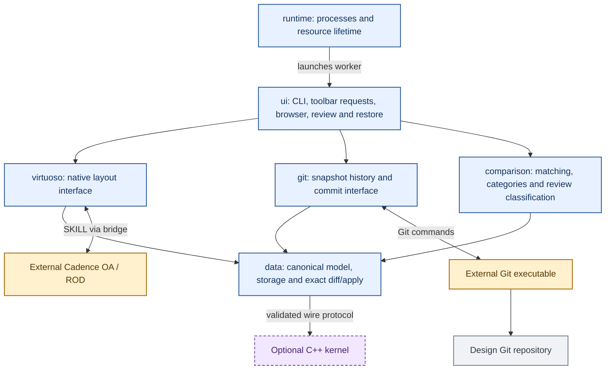
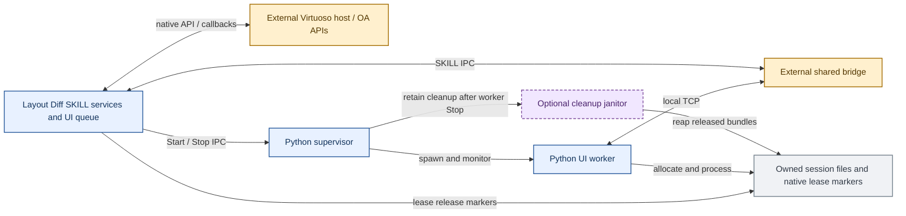
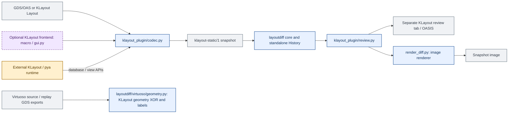

# Program structure and component interactions

The implementation is organized into six functional packages.
The overview diagram uses package boundaries; detailed sequences are linked
separately to keep the main architecture readable. For record fields and algorithms, use the
[data model](../data/MODEL.md) and [processing pipeline](PROCESSING_PIPELINE.md).

The block diagrams use the same visual legend throughout:

| Appearance | Meaning |
| --- | --- |
| Blue, solid border | Layout Diff program component |
| Amber, solid border | External or shared dependency, outside this package |
| Purple, dashed border | Optional or conditionally launched Layout Diff component |
| Gray, solid border | Stored data, input/output artifact or session resource |

Colors indicate ownership and role, not the machine or process hosting a block.
For example, Layout Diff SKILL is program code even though it runs inside
the external Virtuoso host. Optional blocks also have explicit labels and
dashed borders so their meaning does not depend on color alone.

## Functional submodules

The implementation is grouped into six packages. Read this diagram first;
the tables and individual workflows below expand each block.



Arrows show the primary control/data relationships, not every Python import.
`data` is independent of Cadence, Git and the GUI. `comparison` derives display
meaning without changing stored identity. `virtuoso` and `git` are separate
interfaces over that common data. `ui` combines them into user workflows;
`runtime` owns the host processes and temporary-resource lifetime.

## Source layout and entry points

```text
layoutdiff/
  __init__.py              Stable canonical diff/apply helper exports
  __main__.py              python -m layoutdiff
  cli.py                  Compatibility console-entry facade
  git_driver.py           Compatibility for existing textconv configurations
  data/
    core.py               Canonical values, identities, exact reference diff/apply
    storage.py            Streaming v2 snapshot codec and validation
    streaming.py          Sorted wire merge/apply
    streampatch.py        Checked patch bundles
    history.py            Standalone chains and atomic JSON helpers
    backends.py           External snapshot-reader contract
    acceleration.py       Optional C++ dispatch, provenance and parity checks
    native_source.sha256  Packaged source pin
  comparison/
    matching.py           Conservative geometric and via correspondence
    geometry_changes.py   Geometry-only field projection
    review.py             Visible-object status classification
    review_groups.py      Group changes and boundary targets
    categories.py         Category rules, counts and detail formatting
    changeindex.py        Disk-backed category index and paging
  virtuoso/
    adapter.py            Capture, replay and native readback service
    dependencies.py       Hierarchy hints and nonblocking drift warnings
    hash_views.py         Saved OA file fingerprint helper
    logical_groups.py     Native-reference resolution
    oa_content.py         Annotation relationships and replay ordering
    mpp.py                Editable ROD recipe handling
    support.py            Supported-content validation
    omissions.py          Dependency-aware incomplete-checkpoint projection
    native_equivalence.py Narrow native comparison rules
    sexpr.py              Data-only SKILL transport encoding/parsing
    paths.py              Session-owned native scratch paths
    geometry.py           XStream export and independent KLayout GDS checks
    skill/                reader.il, hierarchy.il
  git/
    store.py              Immutable Git snapshot history reads
    commit.py             Preview and isolated Git commit transaction
    tools.py              Repository configuration and semantic textconv
    driver.py             Canonical textconv executable entry
  ui/
    cli.py                CLI command implementation
    worker.py             GuiWorker and workflow orchestration
    browser.py            Cell/repository history presentation models
    restore.py            Confirmed checkpoint-restore state machine
    skill/                gui.il, browser.il, workflow.il, runtime.il
  runtime/
    __main__.py           Stable python -m layoutdiff.runtime entry
    supervisor.py         supervise / worker / reap modes
    workspace.py          Owned temporary bundles and reaping
```

`native-performance/` remains the optional C++ side project;
`klayout_plugin/` remains a separate static-layout frontend. `scripts/`, `tests/`
and `docs/` keep their operational roles outside the installed package.

The startup file is generated by [install_runtime.py](../../scripts/install_runtime.py).
It loads UI SKILL from `ui/skill/`; the adapter loads native database SKILL
from `virtuoso/skill/`. Redeploy through the installer when updating the runtime.

## Python services and data-processing components

| Package | Responsibility | Main entry points |
| --- | --- | --- |
| `virtuoso` | Native capture/replay, scope, ROD/OA relationships, readback, hierarchy and GDS verification | [VirtuosoAdapter](../../layoutdiff/virtuoso/adapter.py), [native resources](../../layoutdiff/virtuoso/skill/reader.il) |
| `git` | Git snapshot paths/history, stale preview checks, isolated commit and semantic diff driver | [GitSnapshots](../../layoutdiff/git/store.py), [prepare_v2 / commit](../../layoutdiff/git/commit.py) |
| `data` | Typed canonical state, integrity, v1/v2 storage, exact operations, standalone chains and acceleration | [core](../../layoutdiff/data/core.py), [Snapshot](../../layoutdiff/data/storage.py), [streaming](../../layoutdiff/data/streaming.py) |
| `comparison` | Inferred correspondence, Moved/stretched versus Modified net, categories, paging and group boundaries | [ChangeIndex](../../layoutdiff/comparison/changeindex.py), [classify](../../layoutdiff/comparison/review.py), [pairs](../../layoutdiff/comparison/matching.py) |
| `ui` | CLI and native GUI workflow coordination, history models, styles, commit/review/restore dialogs | [GuiWorker](../../layoutdiff/ui/worker.py), [HistoryBrowser / RepositoryBrowser](../../layoutdiff/ui/browser.py), [restore](../../layoutdiff/ui/restore.py) |
| `runtime` | Supervisor/worker launch, process identity, locks, session ownership and cleanup | [supervisor](../../layoutdiff/runtime/supervisor.py), [workspace](../../layoutdiff/runtime/workspace.py) |

Within `data`, the exact kernel compares canonical key/record streams. The
`comparison` package then interprets eligible delete/add pairs for display.
Its output never changes the result of exact replay. In particular, geometric
matching remains Python-owned even when the exact merge runs in C++.

## Deployment and process boundaries



This is the runtime view of the same modules, not another layer of data storage.
The supervisor never calls SKILL. It watches the original Virtuoso process
identity and IPC lifetime while owning the worker process group. The worker
polls the native queue and calls services through the shared bridge. A janitor
can continue cleanup after the worker stops; it does not call the bridge.

Normal operation is host-local. Remote development can supply an SSH-backed
bridge client, while the installed worker uses `VirtuosoClient.local` and local
filesystem access. The bridge PID check selects the intended CIW. Loading
indicators do not imply parallel mutation of the native database.

## Request and data interfaces

| Boundary | Payload | How it is used |
| --- | --- | --- |
| GUI callback to worker | SKILL list, e.g. `("review" "LIB" "CELL" "layout" "<revision>")` | Callback appends to `ALDGUIQueue`; worker drains it through `ALDGUIPoll(owner)` and dispatches the command |
| Worker to native services | Bridge SKILL expressions or loaded `.il` helper files | Synchronous service requests after GUI callbacks return; large payloads use file loading |
| Capture to codec | Typed S-expression lines, temporary reference IDs | Python decodes/resolves IDs, validates coverage and writes canonical records |
| Storage to diff kernel | Sorted expanded wire streams | Canonical key and record bytes; C++ does not interpret OA fields |
| Kernel to category index | Exact JSONL operations | SQLite-backed counts, pairing, paging and full detail export |
| Git to browser | Commit metadata and immutable snapshot blobs | History is pinned to revisions, independent of unrelated worktree/index changes |
| Worker to GUI | SKILL service calls with table rows, summary text, styles and object assignments | Publish a bounded UI view; preserve complete details in snapshot/exports |
| Native leases to cleanup | `lease.json` ownership plus `RELEASED` marker | Delay deletion until native references are gone, or parent process death is established |

The request audit files under `state/.../requests/` record completed requests,
results and errors. They are not the pending request queue. The queue lives in
Virtuoso memory. Requests run serially in the worker; a loading indicator does
not imply that native database operations run concurrently in multiple threads.

## Save and commit interaction

Save in Virtuoso, capture and preview through `ui`, confirm, revalidate and commit
through `git`. [The detailed sequence](../ui/INTERACTION_SEQUENCES.md#save-and-commit-interaction)
includes the optional two-step omission consent and one-use tokens.

## Review and restore interaction

Read selected states through `git`, classify through `comparison`, reconstruct
and verify through `virtuoso`, then open the `ui` overlays. `runtime` retains
the session resources until their native leases end. See the
[review/restore sequence](../ui/INTERACTION_SEQUENCES.md#review-and-restore-interaction).

## Durable state, temporary state and cleanup

| Storage | Owner | Lifetime |
| --- | --- | --- |
| `layouts/<lib>/<cell>/<view>.layout/` in the selected design Git repository | Git transaction | Committed snapshots and optional omission audit |
| Tool source repository | Developer workflow | Python, SKILL, C++, docs and permanent fixtures; separate from design Git |
| Runtime app and `state/ciw-<pid>/` | Installer, supervisor and worker | App files, repository choice, styles/backend preferences, status/logs, request audits and ownership locks |
| System temp `ald-session-*/work/<token>/` | Worker plus native lease callbacks | Replay code, captures, exports, diagnostics, temporary review OA and restore backup bundles |
| SQLite/wire/comparison caches | Snapshot/browser/index owners | Derived files closed with their owning objects; no commit authority |
| Standalone operation-chain archives | Compatibility reader | Read-only GUI inputs; GUI commits write Git snapshots |

`runtime/workspace.py` allocates token-owned work bundles. `ui/skill/workflow.il` tracks native
references, seals a completed bundle and writes its release marker only when
references are gone. `runtime/supervisor.py` reaps released bundles while the worker runs.
If the worker stops with live windows, a bridge-free janitor continues waiting
for releases. Verified Virtuoso process death permits final session cleanup.
The supervisor identifies processes using PID plus boot/start identity to avoid
mistaking a reused PID for its original parent.

This division lets a review remain visible after worker Stop while retaining
the files it still needs. It also prevents filesystem cleanup from guessing
whether an OA cellview is still referenced. The [runtime guide](../runtime/README.md#ownership-and-shutdown)
documents controls and the [verification index](../development/VERIFICATION.md) records the
tested lifecycle boundaries.

## Separate KLayout frontend



`api.py` chooses the embedded `pya` binding or standalone KLayout modules.
`codec.py` captures/reconstructs reachable static cells; `klayout_plugin/review.py` creates
review geometry and styles; `render_diff.py` renders an image through KLayout's
view API. This frontend uses its documented standalone history flow, not the
Virtuoso `GuiWorker`/bridge/runtime. Its static snapshot marker keeps it distinct
from native OA snapshots even though it reuses canonical core/history helpers.
It cannot recover native PCell generators or OA connectivity from GDS. See
[KLayout architecture and limits](../klayout_plugin/README.md#snapshot-boundary-and-limitations).

[virtuoso/geometry.py](../../layoutdiff/virtuoso/geometry.py) uses KLayout separately as an
independent verifier of Virtuoso GDS exports. This verification path does not
convert native OA snapshots into the static plugin schema or supply an alternate
native replay implementation.

## Extension boundaries

Add native object support across capture, reference resolution, coverage,
deterministic replay and readback, with a regression for actual semantics.
Adding a display category belongs in presentation/classification and native
controls without changing exact identity. New accelerated kernels belong behind
the validated wire interface and must match the Python reference. An external
OA reader can implement the [SnapshotReader contract](../../layoutdiff/data/backends.py)
and emit the documented logical model; no general-purpose direct OA binding is
currently shipped by this project.

## Public entry points

Use package-qualified internal imports such as `layoutdiff.data.core`,
`layoutdiff.git.commit`, `layoutdiff.ui.worker` and `layoutdiff.virtuoso.adapter`.
The public `layoutdiff` diff/apply helpers, `layout-diff`, `python -m layoutdiff`,
`python -m layoutdiff.runtime`, and `layoutdiff.virtuoso` adapter exports are
available. Root CLI/textconv facades delegate to their owning packages.

## Documentation by component

| Component | Documentation |
| --- | --- |
| `data` | [Data model, formats, streams and acceleration](../data/README.md) |
| `comparison` | [Matching, classification, groups and paging](../comparison/README.md) |
| `virtuoso` | [Capture, coverage and native replay](../virtuoso/README.md) |
| `git` | [Snapshot history and commit transactions](../git/README.md) |
| `ui` | [CLI, toolbar, browser, review and restore](../ui/README.md) |
| `runtime` | [Deployment, process ownership and cleanup](../runtime/README.md) |
| Optional C++ component | [Native performance backend](../native-performance/README.md) |
| Separate KLayout frontend | [Static-layout tools](../klayout_plugin/README.md) |

Cross-component flows live in [the processing guide](PROCESSING_PIPELINE.md) and
[UI interaction sequences](../ui/INTERACTION_SEQUENCES.md).
