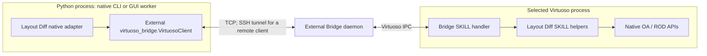

# Virtuoso Bridge integration

Layout Diff builds its native layout interface on
[virtuoso-bridge-lite](https://github.com/Arcadia-1/virtuoso-bridge-lite).
The upstream repository name is `virtuoso-bridge-lite`; its Python distribution
and command are named `virtuoso-bridge`, and its import is `virtuoso_bridge`.

## Responsibility and dependency

| Component | Owns |
| --- | --- |
| Virtuoso Bridge Python client and transport | TCP SKILL requests, connection configuration, optional SSH tunnels, file transfer and native utility APIs |
| Bridge daemon and SKILL handler | Delivery of requests to the selected running Virtuoso CIW and return of results |
| Layout Diff | Canonical layout records, capture/replay helpers, exact and semantic comparisons, Git snapshots, review UI and its supervisor/worker |
| Cadence Virtuoso and the design environment | OA/ROD APIs, technology, referenced masters and PCell evaluation |

Layout Diff imports Bridge as an external package. It loads its own reader and
replay SKILL through that connection; Bridge does not define Layout Diff's
snapshot format, Git history or comparison rules. The supplied installer deploys
copies of both source packages and installs them together in the host environment.

For local agents working with a remote project, the [agent interface](../agent/README.md)
provides a local stdio MCP proxy over this same connection. Remote SKILL mailbox
functions hand requests to the existing Layout Diff worker and return bounded
JSON results. No remote MCP listener is needed; Git and semantic analysis stay
on the Virtuoso host. Direct Bridge agents can use the mailbox without MCP.

| Operation | Needs Virtuoso Bridge? | Other requirements |
| --- | --- | --- |
| File-only diff/apply, encode/decode, standalone chain replay, offline Git snapshot reads | No | Python and input files; Git for Git operations |
| KLayout static capture/review/rendering | No | KLayout bindings; rendering dependencies described in its guide |
| Native capture, record, restore, live hierarchy checks and native stream export | Yes | Running Virtuoso, loaded Bridge setup, accessible technology/masters; export also needs the relevant Cadence tools |
| Native GUI commit/history/review controls | Yes | Bridge connection plus the deployed Layout Diff runtime |
| Bridge Spectre simulation service | Not used by Layout Diff | Independent of layout capture/replay |

[pyproject.toml](../../pyproject.toml) deliberately has no mandatory runtime
dependencies for the core. It declares neither a Bridge extra nor a Bridge
version constraint. Installing Layout Diff alone therefore does not install
Bridge. Native workflows require it in each Python environment that runs them.

## Install the Python packages

From the Layout Diff checkout, create a virtual environment and install Bridge
explicitly from its checkout:

```sh
uv venv .venv
uv pip install --python .venv/Scripts/python.exe -e /path/to/virtuoso-bridge-lite -e ".[verify]"
```

On Linux use `.venv/bin/python`. Activate that environment for the commands below.
This installs both packages in the same environment; a separate Bridge-only
environment does not make `virtuoso_bridge` importable by Layout Diff.

Native integration uses `VirtuosoClient`, `execute_skill`, `load_il`, file helpers,
and, for selected operations, Bridge layout/XStream and SSH-runner APIs. There is
no declared compatibility range for arbitrary Bridge releases; use a checkout
providing those APIs and validate native integration in the target environment.

## Establish and verify the bridge first

For a remote Virtuoso host, first establish passwordless SSH, then configure
Bridge. Substitute your own account and host:

```sh
ssh user@virtuoso-host echo ok
virtuoso-bridge init user@virtuoso-host
virtuoso-bridge start
```

For a bastion route, `init` also accepts `-J user@jump-host`. Start Virtuoso on
the intended host, then paste the exact generated `load(...)` line printed by
`start` into that CIW. This loads the Bridge setup and starts its daemon.
Starting an SSH tunnel alone does not load the CIW handler.

```sh
virtuoso-bridge status
virtuoso-bridge eval '1+2'
```

Require a responsive daemon and a result of `3` before installing or using native
Layout Diff. A missing Spectre service does not block these layout operations.
Loading the Bridge setup and loading Layout Diff's `startup.il` are separate
steps: Bridge must already work before native runtime deployment or startup.

`init` creates the user configuration at `~/.virtuoso-bridge/.env`. Bridge can
instead resolve a project `.env` by walking upward from the working directory;
its CLI also accepts explicit `--env`. Keep these files ignored. See the
[upstream setup guide](https://github.com/Arcadia-1/virtuoso-bridge-lite#quick-start)
for host roles and configuration details.

When Python and Virtuoso run on the same machine, set
`VB_REMOTE_HOST=localhost` in the ignored Bridge configuration and use the same
start/load/status sequence. Bridge skips the SSH tunnel in local mode. This
supports direct native CLI access; the supplied deployment installer still has
the SSH-runner requirement described below.

## Connection paths



| Caller | Connection selection | File access |
| --- | --- | --- |
| Standalone native CLI and installer | `VirtuosoClient.from_env()` resolves Bridge configuration/profile and the client-side tunnel endpoint | Bridge file helpers transfer data for remote access |
| Installed GUI worker | `VirtuosoClient.local(port=port)` connects directly on the Virtuoso host | Host-local files; no desktop SSH configuration is read |
| Python adapter integration | Caller supplies a configured client, including `from_env(profile=...)` or `from_tunnel(...)` | Follows the supplied client and adapter context |

The native Layout Diff CLI uses Bridge's resolved default, including a
virtual-environment profile binding. The deployment installer additionally
accepts `--profile NAME` to select a connection explicitly; see
[manual deployment](DEPLOYMENT.md). For native CLI work with multiple profiles,
bind the active environment with
`virtuoso-bridge profile bind MY_PROFILE --venv`, or supply an explicitly selected
client when using the Python adapter. A `-p` passed only to a separate Bridge CLI
command does not select the profile for a later Layout Diff process.

The client-side forwarded port used by a remote developer can differ from the
daemon port on the Virtuoso host. The GUI worker needs the host-local daemon
port. Its SKILL launcher uses `ALDRuntimeBridgePort` when pinned by the startup
configuration, otherwise `RBPort`, and passes that port and the owning CIW PID
to the supervisor. The worker queries the Bridge endpoint's Virtuoso PID and
refuses a mismatch before touching UI or database state.

## Installer layout and host assumptions

The provided [installer](../../scripts/install_runtime.py) reads Bridge source
from its **parent checkout**, with this exact relative layout:

```text
virtuoso-bridge-lite/
  pyproject.toml
  src/virtuoso_bridge/
  analog-layout-diff/
    pyproject.toml
    layoutdiff/
    scripts/install_runtime.py
```

The two projects can have independent Git repositories. For this installer,
Layout Diff must be nested at the shown location; having two sibling checkouts
or only an installed Bridge wheel does not supply the expected source paths.
Standalone CLI use does not require this directory arrangement.

The installer also calls the configured client's `ssh_runner` for host commands
and uploads the deployment bundle. It requires an SSH-backed Bridge connection;
a bare `VirtuosoClient.local(...)` connection has no SSH runner. The deployed
GUI worker subsequently uses local TCP and needs no continuing desktop tunnel.

The built-in GUI supervisor uses Linux `/proc`, process groups and local locks.
It assumes Virtuoso, its IPC-launched children, the Bridge daemon endpoint and
the relevant OA filesystem are on the same Linux host. Bridge's more general
split-host routing does not by itself make that topology supported by this GUI
runtime. Each concurrent CIW needs its own verified Bridge port and runtime
state directory; the standard installer uses `<destination>/state`, so choose
separate deployment destinations/startup configurations for concurrent sessions.

## Separate lifetimes and diagnostics

**Layout Diff Runtime > Stop** stops its supervisor/worker and releases its own
resources. It does not stop the shared Bridge daemon or developer SSH tunnel.
Restarting Layout Diff reuses the existing Bridge. Stopping Bridge independently
breaks native requests until that connection is restored. File-only operations
remain available without either service.

| Symptom | Check |
| --- | --- |
| `ModuleNotFoundError: virtuoso_bridge` | Install Bridge into the interpreter running the CLI, installer or worker |
| TCP connection fails or daemon does not respond | Verify Bridge setup is loaded in the intended CIW and the selected endpoint/tunnel is reachable |
| Bridge works but Layout Diff controls are absent | Deploy/load Layout Diff's generated `startup.il` after Bridge setup |
| Worker reports a different Virtuoso process | Match its daemon port, CIW identity and per-session startup configuration |
| Installer cannot find Bridge source or its SSH runner | Check the parent source layout and SSH-backed `from_env()` configuration |

See [runtime ownership](README.md#ownership-and-shutdown),
[native adapter coverage](../eda/virtuoso/README.md), and
[CLI dependency limits](../ui/CLI.md#cli-dependency-boundary).
